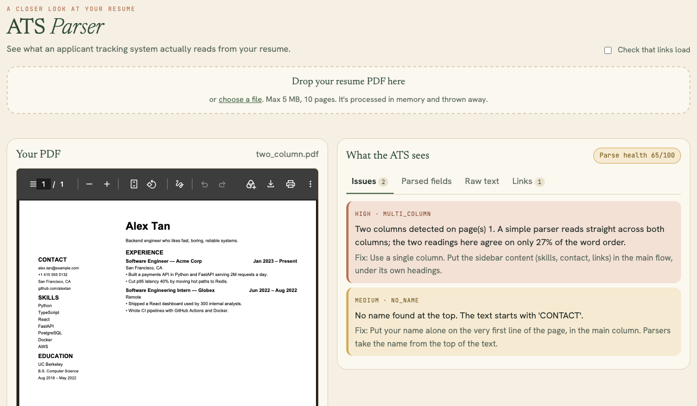
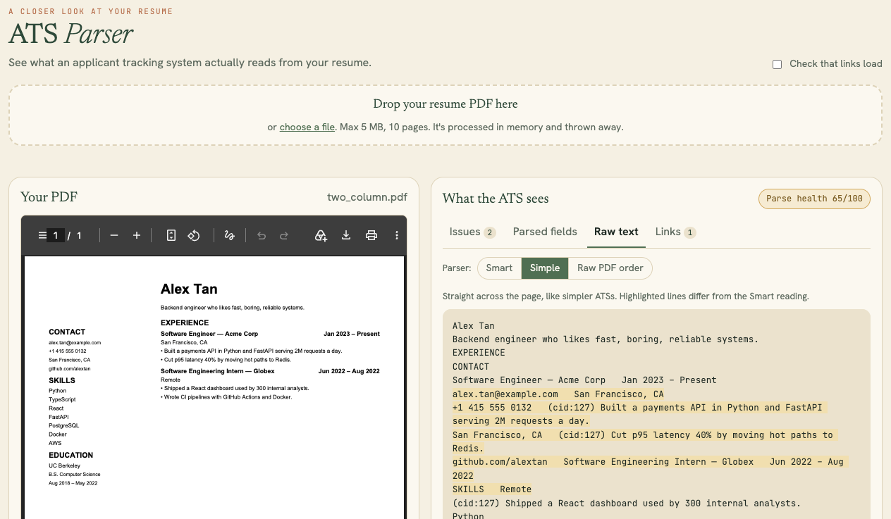

# ats-parser

Upload a resume PDF and see what an Applicant Tracking System actually reads from it:

- **Raw text**, three ways: a column-aware "smart" parser, a "simple" parser that
  reads straight across the page, and the raw order stored in the PDF.
- **Parsed fields:** name, email, phone, location, jobs (title, company, dates,
  bullets), education, skills, and the keywords a recruiter search would match.
- **Links:** which URLs a recruiter will see, which are hidden behind words like
  "Portfolio", which don't match their visible text, and (optionally) which are dead.
- **Issues**, each with a fix: multi-column layouts, image-only PDFs, garbled fonts,
  contact info in the page header, non-standard headings, tables, icon fonts.

Parsing is deterministic and rule-based, with no LLM, so it fails where real ATS
parsers fail instead of quietly fixing things. Uploads are processed in memory and
never stored.



The same resume read the way a simpler ATS reads it, straight across the page. The
sidebar's contact details and skills end up mixed into the job bullets:



## Run locally

```bash
uv venv --python 3.12 .venv
uv pip install --python .venv -r requirements-dev.txt

# web UI on http://localhost:8000
PORT=8000 .venv/bin/python -m app.main

# or the CLI
.venv/bin/python -m app.cli resume.pdf --check-links
```

## Docker

```bash
docker build --platform linux/arm64 -t ats-parser .
docker run --rm -p 8000:8000 ats-parser
```

The app listens on `PORT` (default **8000**) and uses about 45 MB of RAM. It needs no
persistent storage. Optional settings are listed in `.env.example`.

## API

`POST /api/parse`: multipart form with `file` (PDF, ≤5 MB, ≤10 pages) and optional
`check_links=true`. Returns JSON with `engines`, `fields`, `legacy_fields`, `links`,
`issues` and `score`. `GET /health` returns `{"ok": true}`.

## Tests

```bash
.venv/bin/python tests/make_fixtures.py   # regenerate the fixture PDFs
.venv/bin/python -m pytest -q
```

## Accuracy

No tool reproduces every ATS exactly; they use different, closed parsers. The
claim is narrower: if both the Smart and Simple readings come out clean with no
high-severity issues, mainstream ATSs will parse the resume well.
